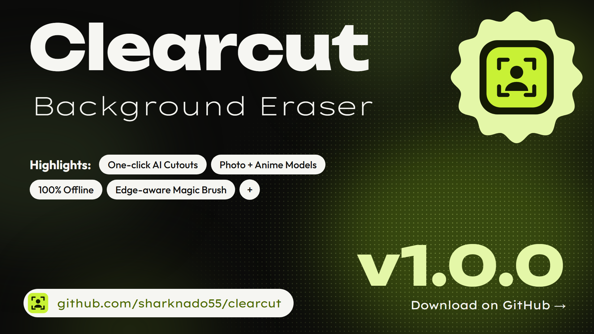

# Clearcut

Clearcut is an offline background eraser for 64-bit Windows. Open an image, choose **Photo** or **Anime** under **Remove background**, refine the cutout, and select **Export PNG** to save transparency.

| Tool | How to use it |
| --- | --- |
| Remove background | Choose **Photo** (**A**) for photographs or **Anime** (**Shift+A**) for drawn characters. |
| Erase and Repair | Press **E** or **R**, then paint to remove or restore pixels. |
| Magic | Press **M**, then paint over a region to remove connected colors within the brush. Lower tolerance for subtler edges. |
| Auto Color | Press **G**, then click inside a connected area to erase similar colors. Lower tolerance if the fill crosses a subtle edge. |
| Crop and Smooth | Press **C** to draw a crop or **S** to choose a smoothing radius. Select **Apply** to commit the change. |

Scroll to zoom, drag with the middle or right mouse button to pan, press **0** to fit the image, and press **B** or use the background menu to preview transparency on a light checkerboard, dark checkerboard, solid black or solid white. Press **V** or select **View original** to compare and **Ctrl+Z** to undo. With the canvas focused, the arrow keys move the editing point, **Shift** moves it faster, and **Space** applies the tool at that point. Press **Ctrl+O** to open an image or **Ctrl+S** to export.

## Download

Download `Clearcut-v1.0.0-win-x64.zip` from the [latest release](https://github.com/sharknado55/clearcut/releases/latest), extract it, and run `Clearcut.exe`. It needs no installer and no .NET runtime. Both AI models are built in, so it works fully offline. Windows SmartScreen may warn about an unsigned app; select **More info**, then **Run anyway**.

You can also drop an image onto `Clearcut.exe`, or choose Clearcut from **Open with** in File Explorer.

## How it works

Automatic removal runs at 1024 × 1024 in full precision on the CPU. Auto Color fills from the clicked pixel using a feathered Oklab color tolerance. Magic follows nearby colors within the brush and stops at sharp color changes.

## Build from source

Use the .NET 10 SDK on Windows. The models are too large to store in git, so download them first. The script checks each file's SHA-256 hash.

    powershell -ExecutionPolicy Bypass -File scripts/get-models.ps1

Build a release zip in `release/` with `scripts/package.ps1`, or publish by hand:

    dotnet publish src/Clearcut.csproj -c Release -r win-x64 --self-contained -p:PublishSingleFile=true -p:IncludeNativeLibrariesForSelfExtract=true -p:EnableCompressionInSingleFile=true -p:DebugType=None --source https://api.nuget.org/v3/index.json -o release

Run the focused editing and PNG checks with `dotnet run --project tests/Clearcut.Checks.csproj -c Release`. To check inference too, pass an existing output directory followed by one or more images after `--`. Insert `--anime` between the output directory and the images to test Anime mode.

Photo uses [BiRefNet Lite](https://huggingface.co/onnx-community/BiRefNet_lite-ONNX) under the MIT license. Anime uses [SkyTNT’s ISNet anime segmentation model](https://huggingface.co/skytnt/anime-seg) under Apache 2.0. Both licenses are in the release notices.

The banner is `docs/banner.html`. Re-render `docs/banner.png` with `scripts/render-banner.ps1`.

## License

Clearcut is released under the [PolyForm Noncommercial License 1.0.0](LICENSE.md). You can use, change and share it for any noncommercial purpose, including personal use, research, education and charities. Commercial use needs separate permission from the author. The bundled AI models keep their own licenses (MIT and Apache 2.0), listed in `release/notices`.
