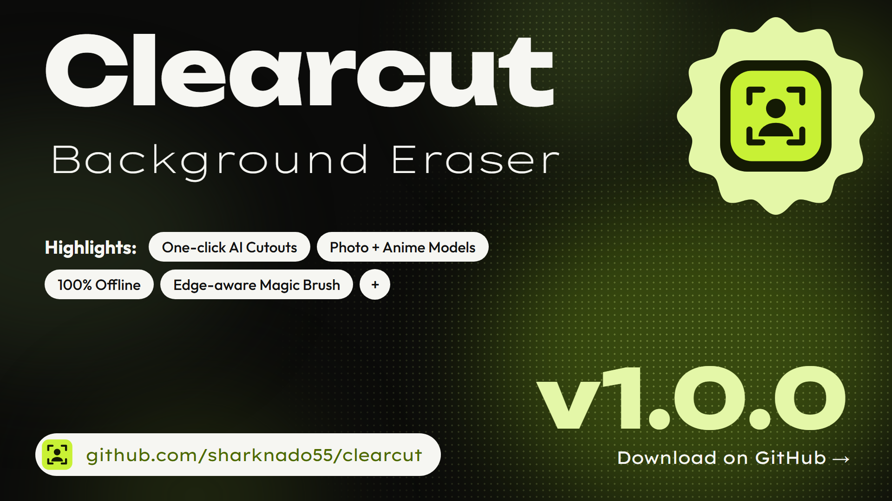

The first release of Clearcut, an offline background eraser for Windows.

**Highlights**
- One-click background removal with two built-in AI models: **Photo** (BiRefNet Lite) and **Anime** (ISNet anime segmentation)
- Runs fully offline on the CPU, with no account, upload or installer
- Refine tools: Erase, Repair, edge-aware Magic brush, Auto Color fill, Crop and Smooth
- Preview transparency on a light checker, dark checker, solid black or solid white background (**B**)
- Compare with the original (**V**), unlimited-feeling undo and redo, and a PNG export that keeps transparency
- Open images by dropping them on the window or the exe, or with **Open with**

**Install**
Download `Clearcut-v1.0.0-win-x64.zip`, extract it, and run `Clearcut.exe`. It needs 64-bit Windows 10 or 11. If SmartScreen warns about an unsigned app, select **More info**, then **Run anyway**.
